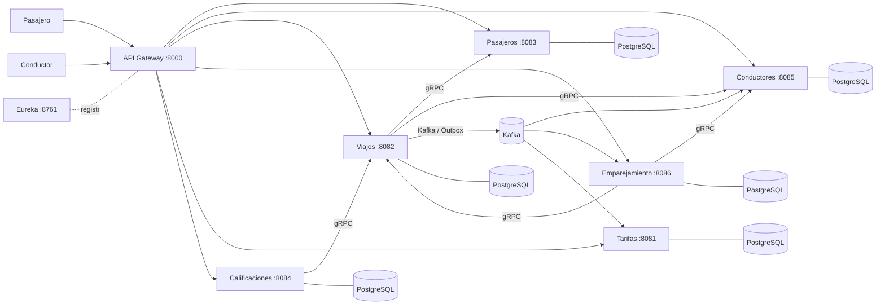

# Arquitectura de Ride Hailing (tal como está construida)

## Visión general

Ride Hailing es una plataforma de transporte con pasajeros, conductores, viajes,
emparejamiento de ofertas, tarifas y calificaciones. La arquitectura es híbrida:
conserva una aplicación monolítica modular en la raíz del repositorio (`src/`),
usada como referencia de la evolución, y seis microservicios Spring Boot
independientes, cada uno con su propia base PostgreSQL. Un API Gateway
(Spring Cloud Gateway) es el punto de entrada REST y Eureka ofrece descubrimiento
de servicios. Todo se levanta con `docker-compose.yml`.

Cada servicio sigue arquitectura hexagonal (puertos y adaptadores) con tres
capas: `domain` (reglas de negocio sin dependencias de frameworks),
`application` (casos de uso y puertos) e `infrastructure` (controladores REST,
adaptadores JPA, clientes gRPC y mensajería).

## Diagrama de contenedores

El diagrama C4 completo está en `docs/architecture/ride-hailing-c4.puml`.

## Comunicación entre servicios

- **Síncrona:** REST a través del gateway para clientes; gRPC entre servicios
  para consultas (Viajes→Pasajeros/Conductores, Emparejamiento→Viajes/Conductores,
  Calificaciones→Viajes), con deadline de 5 segundos.
- **Asíncrona:** Viajes publica eventos (`viajes.solicitados`, `asignados`,
  `finalizados`, `cancelados`, `rechazados`) en Kafka mediante Transactional
  Outbox; Conductores, Emparejamiento y Tarifas los consumen.

## Decisiones de arquitectura

### ADR-001: Base de datos propia por servicio

- **Contexto:** los servicios deben evolucionar y desplegarse de forma independiente.
- **Decisión:** cada servicio tiene su propio PostgreSQL; ningún servicio lee
  tablas de otro.
- **Alternativas consideradas:** una base compartida con esquemas por servicio;
  mantener las bases H2 del monolito.
- **Consecuencias:** se logra autonomía y límites claros, pero no hay joins entre
  servicios, los datos de otros se consultan por contrato (gRPC) y aumentan las
  bases que operar.

### ADR-002: gRPC para consultas síncronas entre servicios y REST hacia el exterior

- **Contexto:** los servicios necesitan validar datos de otros durante un flujo
  (por ejemplo, que el viaje exista antes de calificar).
- **Decisión:** contratos `.proto` versionados para la comunicación interna con
  deadline de 5 segundos; REST solo para clientes externos vía gateway.
- **Alternativas consideradas:** REST con RestClient entre servicios; todo
  mediante mensajería.
- **Consecuencias:** contratos tipados y menor latencia, pero se requiere generar
  código desde `.proto` y manejar la indisponibilidad del servicio remoto de forma
  explícita (error 503 diferenciado del error de negocio).

### ADR-003: Kafka con Transactional Outbox para eventos de viaje

- **Contexto:** al cambiar el estado de un viaje otros servicios deben enterarse
  sin perder eventos si Kafka cae.
- **Decisión:** Viajes escribe el evento en la tabla `outbox_event` dentro de la
  misma transacción y un publicador lo envía a Kafka después.
- **Alternativas consideradas:** publicar directamente en Kafka tras el commit;
  eventos en memoria (como el monolito); two-phase commit.
- **Consecuencias:** cero eventos confirmados perdidos y desacople temporal entre
  servicios, a costa de consistencia eventual, posible duplicación (los
  consumidores deben ser idempotentes) y una tabla y un publicador adicionales.

### ADR-004: API Gateway y Eureka como entrada y descubrimiento

- **Contexto:** los clientes no deben conocer direcciones de cada servicio.
- **Decisión:** Spring Cloud Gateway enruta por prefijo `/api/...` y Eureka
  registra las instancias.
- **Alternativas consideradas:** que los frontends llamen a cada servicio;
  configuración estática de URLs o balanceador externo.
- **Consecuencias:** un único punto de entrada y descubrimiento dinámico, pero el
  gateway y Eureka son puntos únicos de fallo y suman dos componentes más.

### ADR-005: Conservar el monolito modular como referencia

- **Contexto:** el sistema nació como monolito modular antes de separarse.
- **Decisión:** mantenerlo en `src/` sin eliminarlo durante la migración.
- **Alternativas consideradas:** borrarlo al terminar cada extracción; migrar
  todo de una sola vez.
- **Consecuencias:** permite comparar comportamiento y retroceder, pero existe
  riesgo de reglas duplicadas que diverjan (recogido en `ATAM-LITE.md`).

## Atributos de calidad

Los escenarios y riesgos están en `ATAM-LITE.md`; la trazabilidad de requisitos,
en `MATRIZ.md`; las reglas de evolución, en `GOBERNANZA.md`.
